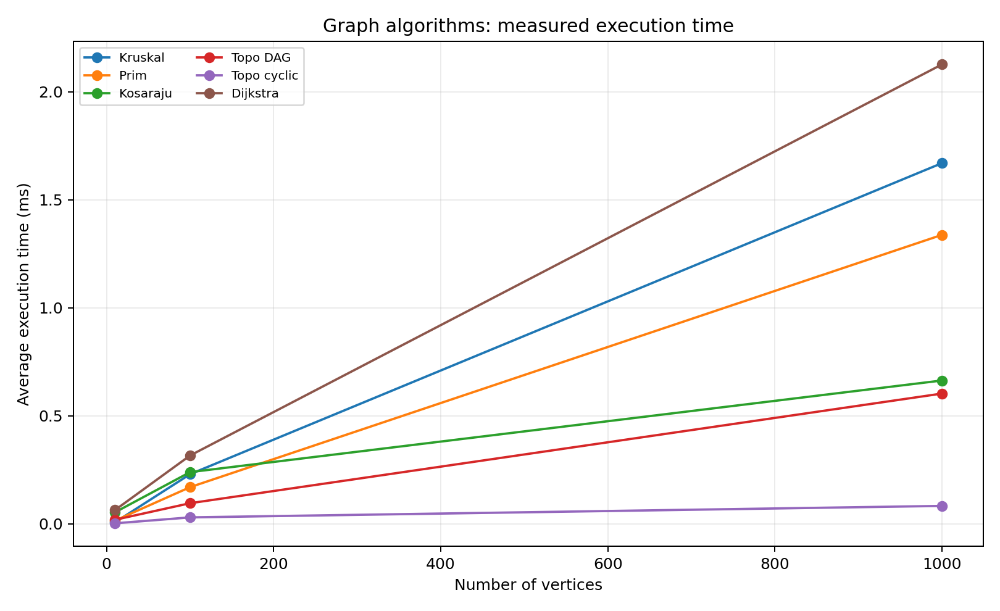

# Assignment 3: Smart City Infrastructure and Route Planning

**Student:** Tolendi Meiirzhan  
**Group:** SE-2539

## 1. Overview

I made a Java program that represents city districts as vertices and roads as weighted edges. It can find a cheap road network, check directed connections, and calculate shortest routes. The program uses an adjacency list because it works well for graphs with relatively few edges.

## 2. Implementation

I divided the Java code into separate packages:

- `src/graph/` contains the graph, its edges, the random graph generator, and the operation counter.
- `src/dsu/` contains the DSU class.
- `src/mst/` contains Kruskal, Prim, and their result class.
- `src/connectivity/` contains topological sorting and Kosaraju SCC.
- `src/shortestpath/` contains Dijkstra and its result class.
- `src/Main.java` runs the demo, tests, and benchmarks.

- **Kruskal:** sorts roads by cost and uses Disjoint Set Union (DSU) to avoid cycles. DSU has path compression and union by rank.
- **Prim:** starts from vertex 0 and chooses the next cheapest road with a priority queue.
- **Topological sort:** uses Kahn's algorithm with indegree counts. If it cannot visit every vertex, there is a cycle.
- **SCC:** uses Kosaraju's algorithm with two DFS passes and reversed edges.
- **Dijkstra:** uses a priority queue and stores the previous vertex to rebuild the route. Unreachable vertices have no path.

For MST, the graph is undirected. For SCC and topological ordering, the graph is directed. The program uses positive weights from 1 to 100, so Dijkstra is valid. Dijkstra is not suitable for negative weights because it assumes that a shortest distance already removed from the queue will not decrease later.

## 3. Complexity Analysis

Here, V means the number of vertices and E means the number of edges. I use adjacency lists and a binary-heap priority queue.

| Algorithm | Time complexity | Extra space | Explanation |
|---|---|---|---|
| DSU find / union | O(α(V)) amortized | O(V) | Path compression and rank keep the sets shallow. α(V) grows extremely slowly. |
| Kruskal | O(E log E + E α(V)) | O(V + E) | Sorting edges takes most of the time. |
| Prim | O(E log V) | O(V + E) | The heap is used to select cheap edges. |
| Kosaraju SCC | O(V + E) | O(V + E) | Both DFS passes process each vertex and edge a constant number of times. |
| Topological sort | O(V + E) | O(V) | All indegrees and edges are processed once. |
| Dijkstra | O((V + E) log V) | O(V + E) | Relaxations and queue operations take time. |

## 4. Experimental Setup

| Graph | Vertices | Edges |
|---|---:|---:|
| Small | 10 | 30 |
| Medium | 100 | 500 |
| Large | 1,000 | 5,000 |

I used `java.util.Random` with fixed seeds based on the graph size. The undirected graphs first get a random spanning tree, so they are guaranteed to be connected. Then the program adds random edges without self-loops or repeated vertex pairs. Directed graphs also have no self-loops or repeated directed edges. The DAG uses only edges from a smaller numbered vertex to a larger one. The cyclic graph allows edges in both directions; the program checks that it actually has a cycle.

I repeated every measurement 5 times with `System.nanoTime()` and calculated the average in milliseconds. Before the measurements I ran each algorithm 3 times for JVM warm-up. I counted operations such as edges examined, heap comparisons, and DSU `find`/`union` calls. These counts are useful for comparing growth, although different algorithms count different kinds of operations. The timings depend on the computer and JVM, so they can change when someone repeats the experiment.

## 5. Results

The program automatically writes the measurements to [benchmark.csv](results/tables/benchmark.csv). I copied those results into the tables below. Both plots are generated from the same CSV file.

These are the results from my run (average of 5 repetitions). Time is in milliseconds.

| Algorithm | V=10, E=30 | V=100, E=500 | V=1000, E=5000 |
|---|---:|---:|---:|
| Kruskal | 0.0071 | 0.2299 | 1.6696 |
| Prim | 0.0147 | 0.1699 | 1.3376 |
| Kosaraju | 0.0533 | 0.2394 | 0.6635 |
| Topological DAG | 0.0187 | 0.0956 | 0.6030 |
| Topological cyclic | 0.0024 | 0.0299 | 0.0829 |
| Dijkstra | 0.0637 | 0.3165 | 2.1265 |

The operation counts are in the CSV file:

| Algorithm | V=10, E=30 | V=100, E=500 | V=1000, E=5000 |
|---|---:|---:|---:|
| Kruskal | 207 | 5,762 | 68,637 |
| Prim | 290 | 9,175 | 125,791 |
| Kosaraju | 90 | 1,500 | 15,000 |
| Topological DAG | 60 | 1,000 | 10,000 |
| Topological cyclic | 30 | 500 | 5,060 |
| Dijkstra | 77 | 1,193 | 11,957 |

## 6. Comparison and Discussion

Both Kruskal and Prim produce the same MST total weight for every generated connected graph. They may select different roads when several edges have equal weights, but the minimum total is still the same. Kruskal needs to sort all edges, while Prim mainly works with the priority queue. Which one is faster can depend on the graph and the machine.

Path compression makes future DSU searches shorter, and union by rank prevents deep trees from forming. This is why the DSU operations are very fast even when the graph is larger.

Kosaraju and topological sorting are both linear in V + E, so the operation counts grow mainly with the graph size. Topological sorting succeeds for the generated DAGs but fails for cyclic directed graphs, as expected. Dijkstra also examines more edges on larger graphs and spends additional time on its priority queue.

The time and operation values do not have to grow at the exact same rate because JVM warm-up, the operating system, and heap operations affect actual execution time. Operation counts are usually more stable for the same input.

## 7. Testing

I added automatic checks in `java -cp out Main test`:

| Test case | Expected result |
|---|---|
| Single vertex | MST is connected with weight 0 |
| Disconnected graph | Kruskal and Prim report that it is not connected |
| Equal road weights / multiple MSTs | Both MST algorithms return the same minimum weight |
| DAG | Topological order contains all vertices and every edge goes forward |
| Directed cycle | No topological ordering is returned |
| Multiple SCCs and isolated vertex | Every vertex appears in exactly one SCC |
| Shortest path | Dijkstra finds the correct distance and full vertex path |
| Unreachable vertex | Dijkstra returns an empty path |
| Negative edge | Dijkstra rejects the edge |
| Random connected graphs (all 3 sizes) | Kruskal and Prim return equal MST weights |

## 8. Conclusion

In this assignment I implemented MST, SCC, topological sorting and shortest path algorithms for a smart city network. Kruskal and Prim are useful for choosing a low-cost infrastructure network. Kosaraju finds groups of mutually reachable districts. Topological sorting helps with dependencies when there are no cycles, and Dijkstra finds the shortest routes when road weights are non-negative. I also tested different graph sizes and compared execution time and operation counts.
